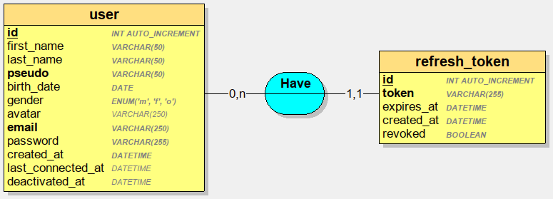

# Motus — Travail préalable individuel

API RESTful en PHP natif et client jQuery, réalisés à partir du boilerplate fourni en cours
(_Technos legacy_, 2025-2026).

Ce dépôt correspond à la partie **« 3. Travail préalable - Individuel »** du sujet : gestion complète
d'un compte utilisateur (authentification, création, modification, suppression) depuis un client jQuery,
avec rafraîchissement automatique du jeton d'accès.

## 📄 Dossier écrit

**[Dossier_oral_partie_individuelle.pdf](./Dossier_oral_partie_individuelle.pdf)** — à la racine du dépôt.

Il contient les deux livrables demandés au point 5.1 du sujet :

1. la présentation de la méthode AJAX ;
2. le rôle de l'_access token_ et du _refresh token_, suivi du schéma des échanges entre le
   navigateur, l'API et la base de données.

## Démarrage rapide

Il n'y a rien à configurer : une seule commande suffit, à la racine du projet.

```shell
docker compose up
```

La commande construit l'image PHP, démarre MySQL, importe le jeu de données
(`stuff/native_php_restful_api.sql`) et attend que la base soit prête avant de lancer l'API.

Une fois les conteneurs démarrés :

- Client jQuery : <http://localhost:8000/client.php>
- API : <http://localhost:8000/api/user>

Pour arrêter : `Ctrl+C`, puis `docker compose down` (ajouter `-v` pour repartir d'une base vierge).

### Personnaliser la configuration (facultatif)

Les valeurs par défaut sont définies dans `docker-compose.yml` et conviennent pour le développement.
Pour les changer, copier `.env.example` en `.env` et adapter les variables :

```shell
cp .env.example .env
```

| Variable          | Défaut                       | Rôle                                        |
|-------------------|------------------------------|---------------------------------------------|
| `DB_HOST`         | `db`                         | Hôte MySQL (`localhost` hors Docker)        |
| `DB_NAME`         | `native_php_restful_api`     | Nom de la base                              |
| `DB_USER`         | `app`                        | Utilisateur MySQL                           |
| `DB_PASS`         | `app_password`               | Mot de passe MySQL                          |
| `JWT_SECRET`      | (clé de démo)                | Clé de signature HMAC des jetons d'accès    |
| `JWT_TTL`         | `300`                        | Durée de vie de l'_access token_ (secondes) |
| `JWT_REFRESH_TTL` | `604800`                     | Durée de vie du _refresh token_ (secondes)  |

### Sans Docker

Si Docker n'est pas disponible, il faut PHP 8.3+ et MySQL 8.0+ :

```shell
cp .env.example .env     # puis remplacer DB_HOST=db par DB_HOST=localhost
mysql -u root -p < stuff/native_php_restful_api.sql
php -S localhost:8000 -t public
```

## Ce que j'ai implémenté

### Côté client (`public/client.php`)

- **Authentification** : formulaire email / mot de passe envoyé en AJAX sur `POST /api/login`.
  L'_access token_ reçu est conservé dans le `localStorage`.
- **Désauthentification** : formulaire réduit à un bouton, qui appelle `POST /api/logout` puis vide
  le `localStorage`.
- **Affichage conditionnel** : `updateAuthView()` affiche les formulaires de connexion et de création
  de compte à l'utilisateur anonyme, et ceux de déconnexion, de modification et de suppression à
  l'utilisateur authentifié.
- **Création de compte** : formulaire complet envoyé sur `POST /api/user`, sans jeton puisque
  l'utilisateur n'est pas encore connecté.
- **Modification** : seuls `pseudo`, `gender` et `avatar` sont modifiables ; l'identifiant ciblé est
  lu dans le _payload_ du JWT, pas saisi par l'utilisateur.
- **Suppression** : confirmation par `confirm()`, puis `DELETE /api/user/{id}`.
- **Gestion des erreurs** : le message affiché dépend du code HTTP (401, 403, 409, autre).

### Rafraîchissement automatique du jeton (3.7)

Toutes les requêtes authentifiées passent par `requestWithRefresh()` :

1. La requête part avec l'en-tête `Authorization: Bearer <access token>`.
2. Si l'API répond **401**, le client appelle `POST /api/token/refresh`. Le navigateur y joint
   automatiquement le cookie `refresh_token` (`HttpOnly`).
3. Si le _refresh token_ est encore valide, un nouvel _access token_ est renvoyé, stocké, et la
   requête initiale est rejouée. L'utilisateur ne voit rien.
4. Sinon, la session est considérée comme expirée : le `localStorage` est vidé et le formulaire de
   connexion réapparaît.

Au chargement de la page, si le jeton stocké est déjà expiré, le rafraîchissement est déclenché
immédiatement afin de ne pas attendre un premier 401.

### Côté API

Modifications apportées au boilerplate :

- **Contrôle du propriétaire** (3.5 et 3.6) : sur `PATCH` et `DELETE /api/user/{id}`, le `user_id`
  du JWT est comparé à l'identifiant de l'URL. En cas de différence, l'API répond **403** sans
  toucher à la base.
- **Compte supprimé** : un jeton encore valide mais dont le compte n'existe plus est rejeté (**401**).
- **Refresh token expiré** : `findByToken()` filtre sur `expires_at > NOW()`, en plus de `revoked = 0`.
- **Données personnelles** : deux jeux de colonnes distincts dans le modèle `User`. Le propriétaire
  reçoit son profil complet, les autres utilisateurs un profil public sans email ni état civil. Le
  hash du mot de passe n'est jamais renvoyé, dans aucun des deux cas.
- **Doublons** : un pseudo ou un email déjà utilisé renvoie **409** plutôt qu'une erreur SQL.
- **`findById()`** renvoie une seule ligne (`fetch`) au lieu d'un tableau de lignes.
- **Configuration** : `.env` devient facultatif. S'il est absent, l'application lit les variables
  d'environnement du conteneur, ce qui permet le démarrage en une commande. Les variables manquantes
  sont détectées au démarrage et journalisées.
- **Nettoyage** : les ébauches inutilisées du boilerplate ont été retirées (route `PUT`, qui ne
  renvoyait aucune réponse, et méthode `setAll()` jamais appelée). `PUT /api/user/{id}` répond
  désormais **405**, ce qui est le comportement correct pour une méthode non gérée.

## Endpoints

| Méthode  | Route                 | Auth | Description                                   |
|----------|-----------------------|------|-----------------------------------------------|
| `POST`   | `/api/login`          | non  | Authentification, renvoie l'_access token_    |
| `POST`   | `/api/logout`         | oui  | Révoque le _refresh token_ courant            |
| `POST`   | `/api/token/refresh`  | cookie | Renvoie un nouvel _access token_            |
| `POST`   | `/api/user`           | non  | Création d'un compte                          |
| `GET`    | `/api/user`           | oui  | Liste des utilisateurs (profils publics)      |
| `GET`    | `/api/user/{id}`      | oui  | Profil complet si propriétaire, public sinon  |
| `PATCH`  | `/api/user/{id}`      | oui  | Modification, **propriétaire uniquement**     |
| `DELETE` | `/api/user/{id}`      | oui  | Suppression, **propriétaire uniquement**      |

### Codes de réponse

| Code  | Signification                                                      |
|-------|--------------------------------------------------------------------|
| `400` | Corps de requête vide ou données requises manquantes                |
| `401` | Non authentifié : jeton absent, invalide, expiré, ou compte supprimé |
| `403` | Action interdite sur le compte d'un autre utilisateur               |
| `404` | Route ou utilisateur introuvable                                    |
| `405` | Méthode non autorisée sur cette route                               |
| `409` | Pseudo ou email déjà utilisé                                        |
| `500` | Erreur interne (détail dans `logs/error.log`)                       |

Toutes les réponses sont au format JSON et contiennent `status`, `message` et, le cas échéant, `data`.

Le sujet ne demande pas de remplacement complet de ressource : `PUT` n'est donc pas implémenté et
renvoie `405`.

## Mécanisme d'authentification

Deux jetons aux rôles distincts :

|                | Access token                                | Refresh token                              |
|----------------|---------------------------------------------|--------------------------------------------|
| Nature         | JWT signé en HS256 (`user_id`, `email`, `exp`) | Chaîne aléatoire de 128 caractères hexadécimaux |
| Durée de vie   | 5 minutes                                   | 7 jours                                     |
| Stockage client| `localStorage`                              | Cookie `HttpOnly`                           |
| Stockage serveur | aucun (vérifié par signature)             | Hash en base, table `refresh_token`         |
| Transmission   | En-tête `Authorization: Bearer`             | Cookie, uniquement vers `/api/token/refresh` |
| Révocation     | impossible, expire seul                     | possible (`revoked = 1`) à la déconnexion   |

L'_access token_ est court pour limiter l'impact d'un vol ; le _refresh token_ est long mais
révocable et jamais exposé au JavaScript.

Le cookie du _refresh token_ est posé avec `HttpOnly` et `SameSite=Lax`, mais sans l'attribut
`Secure` : le projet tourne en HTTP sur `localhost`. En production, il faudrait servir le site en
HTTPS et activer `Secure`.

## Modèle de données



Deux tables : `user` (pseudo et email uniques) et `refresh_token`, reliée à `user` par une clé
étrangère `ON DELETE CASCADE` — supprimer un compte supprime donc ses jetons.

## Structure du projet

```console
├── Dossier_oral_partie_individuelle.pdf
├── public
│   ├── assets              # jQuery 3.7.1 et Pico CSS, servis en local
│   ├── client.php          # client jQuery (formulaires + appels AJAX)
│   ├── front_controller.php # routage, authentification, contrôle du propriétaire
│   └── index.php           # chargement de la configuration et aiguillage
├── src
│   ├── Core                # Database (PDO, singleton) et DotEnv
│   ├── Security            # JwtService : création et vérification des JWT
│   ├── Controller          # UserController : traitements et réponses JSON
│   └── Model               # User : accès à la base
├── helpers                 # journalisation, réponses HTTP, encodage base64url
├── logs                    # error.log
└── stuff                   # dump SQL et MCD
```

## Journalisation

Les exceptions PHP sont écrites dans `logs/error.log` via `logWithDate()`. Les messages d'exception
ne sont jamais renvoyés au client : l'API répond un `500` générique.

Pour suivre les logs pendant l'exécution :

```shell
docker compose logs -f app
```
